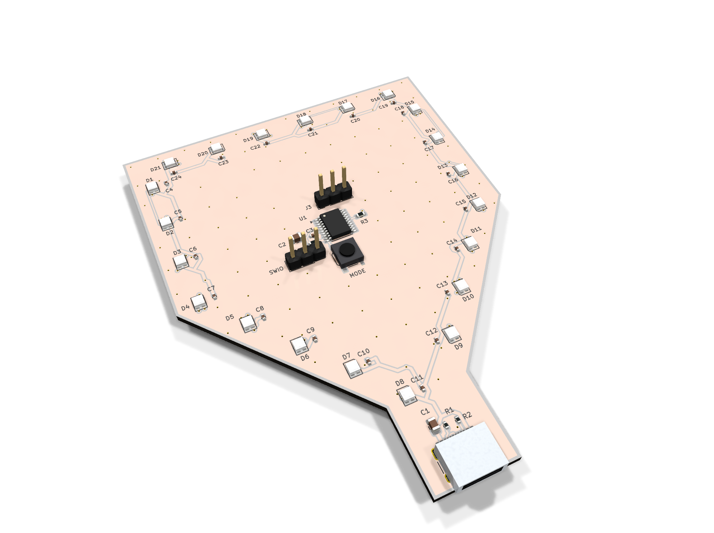

# PALADIN

dented in a hundred battles

| Layers | Size | Parts | Nets | Connections routed | Vias | ERC errors | DRC errors / unconnected / parity |
|---|---|---|---|---|---|---|---|
| 4 | 70.01 x 91.01 mm | 54 | 32 | 138 -> 0 open | 157 | 0 | 0 / 0 / 0 |

**Not fabricated, assembled or powered.** Every number on this page is measured by KiCad 10 on the files in this folder; the full measurements are in [`report.json`](report.json).

| | |
|---|---|
| KiCad project | [`kicad/`](kicad/) |
| Gerbers, BOM, CPL, STEP, schematic PDF | [`fab/`](fab/) |
| Renders | [top](media/top.png), [bottom](media/bottom.png) |

A white knight's shield, dented in a hundred battles. Designed with the HeyPCB method on KiCad 10, by heypcb-kicad's headless pipeline with Freerouting 2.4.1, from the brief in `board.json`.

## Specs

- **Shape:** shield, 70.01 x 91.01 mm, white solder mask, 4 layers, 1.6 mm. A 16 mm tab at the bottom carries the USB-C receptacle.
- **Light:** 21 XL-2020RGBC-2812B addressable RGB LEDs (WS2812B-2020 class, 2 x 2 mm) chained around the outline, each with its own 100 nF.
- **Controller:** CH32V003F4P6 RISC-V MCU at 5 V (so its data output meets the LEDs' 5 V logic with no translator), programmed over the 1-wire SWIO header with a WCH-LinkE; MODE button on PC0.
- **Power:** USB-C 5 V (5.1k on CC1 and CC2). 21 LEDs at full white would draw about 0.8 A, so firmware caps brightness to stay inside a 0.5 A USB port (about 14 % average).

## Parts

Every line carries an LCSC part number. Stock is JLCPCB's assembly stock on 2026-10-19.

| Designators | Value | LCSC | MPN | JLCPCB tier | Stock |
|---|---|---|---|---|---|
| C1,C2 | 10uF | C15850 | CL21A106KAYNNNE | Basic | 6,481,857 |
| C3,C4,C5,C6,C7,C8,C9,C10,C11,C12,C13,C14,C15,C16,C17,C18,C19,C20,C21,C22,C23,C24 | 100nF | C1525 | CL05B104KO5NNNC | Basic | 29,476,420 |
| D1,D2,D3,D4,D5,D6,D7,D8,D9,D10,D11,D12,D13,D14,D15,D16,D17,D18,D19,D20,D21 | XL-2020RGBC-2812B | C5349955 | XL-2020RGBC-2812B | Extended | 100,374 |
| J1 | USB-C | C165948 | TYPE-C-31-M-12 | Extended | 357,307 |
| J2 | SWIO | C2937625 | PZ254V-11-03P | Extended | 924,821 |
| J3 | OUT | C2937625 | PZ254V-11-03P | Extended | 924,821 |
| R1,R2 | 5.1k | C25905 | 0402WGF5101TCE | Basic | 5,086,543 |
| R3 | 33 | C23140 | 0603WAF330JT5E | Basic | 4,946,796 |
| R4 | 10k | C25804 | 0603WAF1002T5E | Basic | 39,931,112 |
| SW1 | MODE | C318884 | TS-1187A-B-A-B | Basic | 290,976 |
| U1 | CH32V003F4P6 | C5187096 | CH32V003F4P6 | Extended | 26,142 |

## Ordering

- PCB: upload `fab/art_paladin_gerbers.zip`, 4 layers, 70.01 x 91.01 mm, 1.6 mm, white solder mask with black silkscreen.
- Assembly: `fab/art_paladin_bom.csv` and `fab/art_paladin_cpl_jlc.csv`, top side.
- The CPL is fitted to each part's own JLCPCB footprint, pad by pad, and re-checked by laying each footprint where its row says: 53 of 54 rows fitted, worst pin-to-pad offset 0.26 mm.
- Not fitted (no JLCPCB footprint to fit to), rotation from KiCad's: SW1. Check these in JLCPCB's placement preview.

## Notes

- The USB-C receptacle renders as a plain box: KiCad's footprint names a 3D model KiCad does not ship.
- Firmware is not part of this repository: the board is the hardware. Not built or measured.

## How it was made

Designed with the HeyPCB method on KiCad 10, by heypcb-kicad's headless pipeline with Freerouting 2.4.1, from the brief in [`board.json`](board.json).

## Licence

CERN-OHL-S-2.0, © 2026 heypcb.ai. See the collection's LICENSE.
